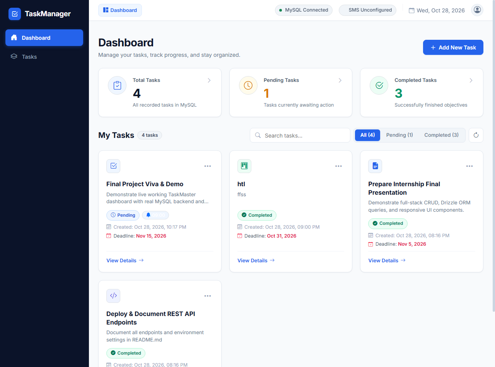
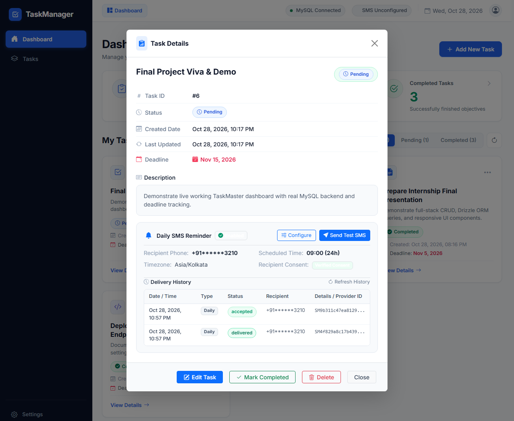
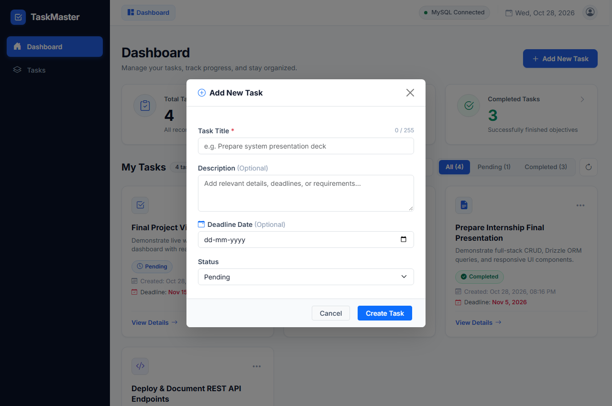
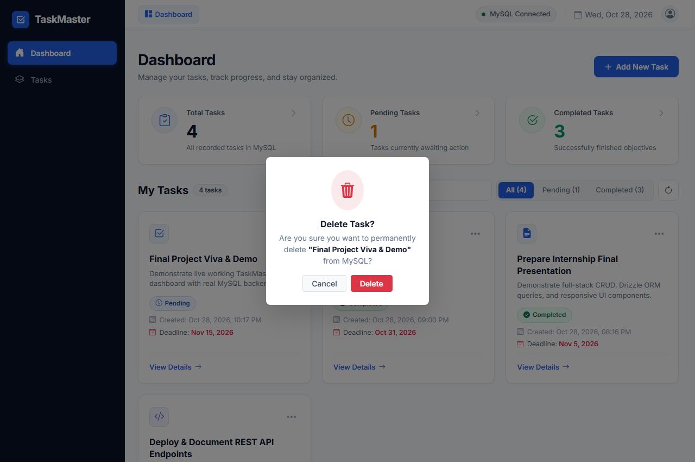

# TaskMaster — Full-Stack Task Management System

A production-ready, responsive, full-stack **Task Management System** built with **Node.js**, **Express.js**, **Drizzle ORM**, and **MySQL**, styled with **Bootstrap 5** and **Tailwind CSS**, and powered by **Vanilla JavaScript**.

---

## 1. Project Overview & Features

TaskMaster allows users to organize their daily productivity with live task tracking, database persistence, and a modern dashboard interface.

### Key Features:
- **Real-Time Dashboard Counters**: Displays real-time counts of Total, Pending, and Completed tasks.
- **Task Creation**: Add tasks with a mandatory title (max 255 chars) and optional rich descriptions.
- **Responsive Card Grid Layout**: Clean, responsive layout for desktop, tablet, and mobile devices.
- **One-Click Status Toggle**: Instantly toggle tasks between `Pending` and `Completed` with animated status badges.
- **Task Editing**: Full in-modal editing for title, description, and status.
- **Safe Task Deletion**: Bootstrap modal confirmation before deleting any record from the database.
- **Instant Filtering & Search**:
  - Filter by `All`, `Pending`, or `Completed` tabs with dynamic badge counts.
  - Live client-side search across task titles and descriptions.
- **Input Validation & Feedback**: Form validation with clear error messages, button loading spinners, and floating toast notifications.
- **Relational MySQL Persistence**: Powered by Drizzle ORM and `mysql2` driver; data persists safely across restarts.

---

## 2. Technology Stack

### Frontend
- **HTML5 & Semantic Markup**
- **CSS3** with custom variables, smooth transitions, and glassmorphism styling
- **Vanilla JavaScript (ES6+)** with Fetch API (No frontend frameworks used)
- **Bootstrap 5.3** (Layout, grid, buttons, forms, modals, toasts, icons)
- **Tailwind CSS v3** (Utility classes, spacing, and custom typography)

### Backend
- **Node.js (v22+)**
- **Express.js (v5)**
- **CORS** middleware

### Database & ORM
- **MySQL (8.0+)**
- **mysql2** (Promise-based connection pool)
- **Drizzle ORM** (Type-safe query builder for SELECT, INSERT, UPDATE, DELETE)
- **Drizzle Kit** (Schema generation and database migrations)

### Environment & Tooling
- **dotenv** (Secure environment configuration)
- **nodemon** (Automatic dev server restart)

---

## 3. Project Structure

```
task-management-system/
├── public/
│   ├── index.html         # Frontend Dashboard UI
│   ├── style.css          # Compiled Tailwind CSS + Custom Design System
│   └── app.js             # Client-side SPA logic & Fetch API requests
├── routes/
│   └── tasks.js           # REST API endpoints using Drizzle ORM
├── db/
│   ├── schema.js          # Drizzle ORM schema definition for tasks table
│   └── index.js           # MySQL2 connection pool & Drizzle ORM client
├── drizzle/
│   ├── 0000_chemical_king_bedlam.sql # Generated SQL migration file
│   └── meta/              # Migration journal snapshots
├── screenshots/
│   ├── dashboard.png      # Genuine screenshot of main dashboard
│   ├── add_task_modal.png # Genuine screenshot of Add Task modal
│   └── delete_modal.png   # Genuine screenshot of Delete modal
├── src/
│   └── input.css          # Tailwind source CSS with custom components
├── database.sql           # Raw SQL database & table creation script
├── drizzle.config.js      # Drizzle Kit configuration
├── tailwind.config.js     # Tailwind CSS template scanning configuration
├── postcss.config.js      # PostCSS configuration
├── package.json           # Scripts, dependencies, and metadata
├── .env                   # Local environment credentials (git ignored)
├── .env.example           # Example environment template
├── .gitignore             # Git ignored files & folders
└── README.md              # Project documentation
```

---

## 4. Prerequisites

Before running the application, make sure you have:
1. **Node.js** (v18.0 or higher recommended, tested on v22.17.0).
2. **MySQL Server** (v8.0+ running locally or remotely on port 3306).

---

## 5. Step-by-Step Setup Guide

### Step 1: Install Dependencies
Open your terminal in the project root directory and run:
```bash
npm install
```

### Step 2: Configure Environment Variables
Copy the `.env.example` file to create your `.env` file:
```bash
cp .env.example .env
```
Edit `.env` with your MySQL server credentials:
```env
PORT=3000
DB_HOST=localhost
DB_PORT=3306
DB_USER=root
DB_PASSWORD=your_mysql_password
DB_NAME=task_management_db
```

### Step 3: Create the MySQL Database
You can create the database using the MySQL CLI or MySQL Workbench:
```bash
mysql -u root -p -e "CREATE DATABASE IF NOT EXISTS task_management_db CHARACTER SET utf8mb4 COLLATE utf8mb4_unicode_ci;"
```
*(Alternatively, execute the queries in `database.sql` directly).*

### Step 4: Run Drizzle ORM Migrations
Push the schema to MySQL using Drizzle Kit:
```bash
# Push schema directly to database
npm run db:push

# Or generate new migration SQL files
npm run db:generate
```

### Step 5: Compile Tailwind CSS
If you modify `src/input.css` or template classes, recompile the stylesheet:
```bash
npm run build:css
```
*(For continuous development, you can run `npm run watch:css` in a separate terminal).*

### Step 6: Start the Server
```bash
# Start in production mode
npm start

# Or start in development mode with nodemon auto-restart
npm run dev
```

The server will display:
```
✔ Connected to MySQL database successfully.
✔ Server is running on http://localhost:3000
```

### Step 7: Open the Application
Open your web browser and navigate to:
```
http://localhost:3000
```

---

## 6. REST API Documentation

All routes return standard JSON responses with HTTP status codes.

| Method | Endpoint | Description | Request Body |
| :--- | :--- | :--- | :--- |
| `GET` | `/api/tasks` | Get all tasks (supports `?status=Pending` or `?status=Completed`) | None |
| `GET` | `/api/tasks/:id` | Get single task by ID | None |
| `POST` | `/api/tasks` | Create new task | `{ "title": "Required string", "description": "Optional string", "status": "Pending" }` |
| `PUT` | `/api/tasks/:id` | Update full task details | `{ "title": "Required string", "description": "Optional string", "status": "Completed" }` |
| `PATCH` | `/api/tasks/:id/status` | Toggle or change task status | `{ "status": "Pending" \| "Completed" }` |
| `DELETE`| `/api/tasks/:id` | Delete task by ID | None |

### Sample cURL Commands:

#### 1. Create a Task
```bash
curl -X POST http://localhost:3000/api/tasks \
  -H "Content-Type: application/json" \
  -d '{"title": "Review Q3 Goals", "description": "Evaluate team KPIs and benchmarks", "status": "Pending"}'
```

#### 2. Get All Tasks
```bash
curl http://localhost:3000/api/tasks
```

#### 3. Update Task Status (PATCH)
```bash
curl -X PATCH http://localhost:3000/api/tasks/1/status \
  -H "Content-Type: application/json" \
  -d '{"status": "Completed"}'
```

#### 4. Delete a Task
```bash
curl -X DELETE http://localhost:3000/api/tasks/1
```

---

---

## 7. Daily SMS Reminder System & Architecture

TaskMaster includes an enterprise-grade, daily automated SMS reminder feature powered by **Twilio**, **node-cron**, **Luxon**, and **MySQL**.

### 7.1 Key Capabilities:
- **Per-Task Settings**: Each task can have SMS reminders enabled with custom recipient mobile number, daily reminder time (HH:mm), and IANA timezone (default `Asia/Kolkata`).
- **Duplicate Prevention**: Database-level unique constraint on `(taskId, scheduledDate)` guarantees that no more than one scheduled daily SMS is delivered per task per local calendar date, even across server restarts or multi-instance clusters.
- **Atomic Claiming / Distributed Locking**: Uses atomic MySQL inserts with status `processing` prior to provider dispatch. Database transactions are never held open while awaiting SMS network responses.
- **Task Lifecycle Awareness**: Reminders are strictly dispatched only when tasks remain `Pending`. If a task is marked `Completed` or deleted, future reminders automatically cease. If reopened, reminders resume while honoring duplicate rules.
- **Provider Isolation & Mock Fallback**: When Twilio credentials are missing in `.env`, the system safely falls back to mock logging mode without crashing application functionality.
- **Test SMS Isolation**: The "Send Test SMS" feature allows instant provider testing without consuming or interfering with the daily scheduled dedup keys.
- **Privacy & Security**: Mobile numbers are masked in logs and user interfaces (e.g. `+91 ******3210`). Explicit recipient consent is mandatory before reminders can be enabled.

---

## 8. SMS Provider Configuration & Environment Variables

Add the following keys to your `.env` file:

```env
# Twilio SMS Credentials
TWILIO_ACCOUNT_SID=your_twilio_account_sid_here
TWILIO_AUTH_TOKEN=your_twilio_auth_token_here
TWILIO_PHONE_NUMBER=+1234567890
APP_TIMEZONE=Asia/Kolkata
```

> [!NOTE]
> If credentials are not configured, TaskMaster runs in simulated/mock mode and displays `SMS Unconfigured` in the dashboard navbar. The rest of the application remains fully functional.

### India SMS Regulatory Readiness (DLT & TRAI):
When delivering SMS to Indian phone numbers (`+91`):
1. **DLT Registration**: Enterprise sender registration on an Indian Telecom DLT portal (e.g., Vilpower/Jio/Airtel/Vodafone DLT) is required by TRAI regulations.
2. **Sender ID (Header)**: A 6-character registered Header/Sender ID (e.g., `TSKMST`) must be approved.
3. **Template Approval**: The SMS message template must be registered and approved on DLT:
   `TaskMaster Reminder: Your task '{#var#}' is still pending. Please review and complete it today.`
4. **Twilio India Route**: Register your Principal Entity ID and DLT Template ID with Twilio Support to route Indian messages compliant with local anti-spam regulations.

---

## 9. Database Migrations

TaskMaster uses non-destructive database migrations. To apply the reminder tables:

```bash
# Run safe database migration
npm run db:migrate
```

### Tables Created:
- `task_reminders`: Stores per-task reminder configuration (`enabled`, `phoneNumber`, `reminderTime`, `timezone`, `consentGiven`, `taskId` with `ON DELETE CASCADE`).
- `reminder_logs`: Stores complete delivery audit trail (`status`, `scheduledDate`, `attemptedAt`, `deliveredAt`, `providerMessageId`, `errorMessage`, `isTest`, `dedupKey` with `UNIQUE` constraint).

---

## 10. Daily SMS Scheduler & Retry Policy

- **Execution**: The scheduler executes every minute (`* * * * *`) via `node-cron`.
- **Due Evaluation**: Evaluates candidate tasks against their configured timezone using Luxon:
  `DateTime.now().setZone(timezone)`.
- **Catch-Up Logic**: If the server was temporarily offline during the scheduled minute, it catches up on the first subsequent run for the same local calendar date.
- **Crash Recovery**: Stale locks in `processing` status older than 10 minutes are automatically recovered.
- **Uncertain Outcomes**: If a network timeout occurs while awaiting Twilio's response, status is recorded as `unknown`. To avoid spamming recipients, automated same-day blind retries are prevented.

---

## 11. REST API Endpoints

| Method | Endpoint | Description |
| :--- | :--- | :--- |
| `GET` | `/api/tasks` | Get all tasks (includes `reminderEnabled` & `reminderTime`) |
| `GET` | `/api/tasks/:id` | Get single task with its reminder settings |
| `POST` | `/api/tasks` | Create task with optional `reminder` configuration |
| `PUT` | `/api/tasks/:id` | Update task details and optional reminder settings |
| `PATCH`| `/api/tasks/:id/status` | Toggle status between `Pending` and `Completed` |
| `DELETE`| `/api/tasks/:id` | Delete task (cascades to reminders & logs) |
| `GET` | `/api/tasks/:id/reminder` | Retrieve task reminder configuration |
| `PUT` | `/api/tasks/:id/reminder` | Save or update task reminder settings |
| `GET` | `/api/tasks/:id/reminder-history`| Retrieve masked delivery history audit trail |
| `POST` | `/api/tasks/:id/reminder/test` | Dispatch rate-limited test SMS immediately |
| `GET` | `/api/health` | Application health and safe SMS provider status |

---

## 12. Automated Testing

To run the complete automated test suite covering unit validation, MySQL settings persistence, duplicate protection, task completion rules, test isolation, and cascade cleanup:

```bash
npm test
```

All 14 automated tests run against your local database with mocked provider responses to avoid unintended carrier charges.

---

## 13. Common Troubleshooting & Gotchas

1. **MySQL Access Denied (Error 1045)**:
   - Double-check your `DB_PASSWORD` in `.env`.
   - Verify that your MySQL user has access to `task_management_db`.
2. **Port 3000 in Use (EADDRINUSE)**:
   - Change `PORT=3001` in `.env` and restart the server.
3. **Tailwind CSS Styles Not Reflecting**:
   - Run `npm run build:css` after editing HTML classes or `src/input.css`.
4. **SMS Provider Not Configured**:
   - Set valid `TWILIO_ACCOUNT_SID`, `TWILIO_AUTH_TOKEN`, and `TWILIO_PHONE_NUMBER` in `.env`.

---

## 14. Live Application Screenshots

### 1. Main Dashboard (Desktop View with SMS Bell Badges)


### 2. Task Details Modal (with SMS Reminder & Delivery History)


### 3. Add New Task Modal (with Daily SMS Reminder Switch)


### 4. Delete Confirmation Modal


